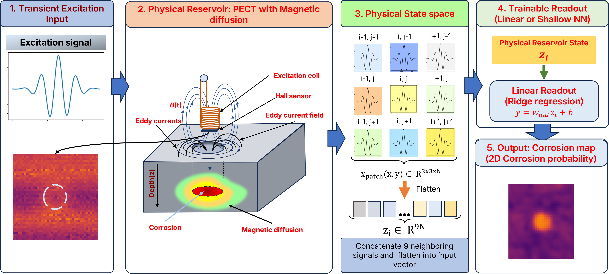
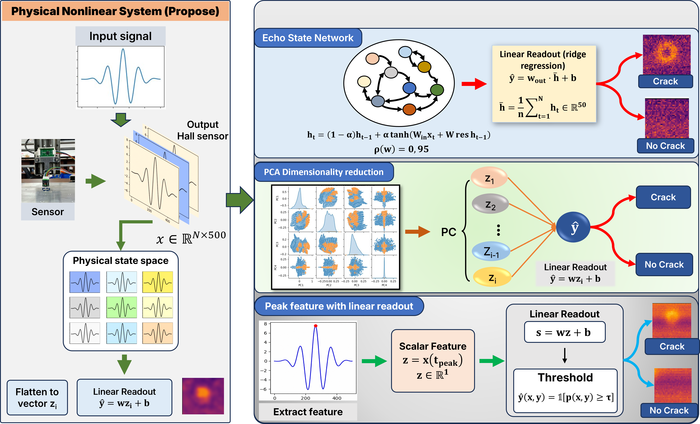
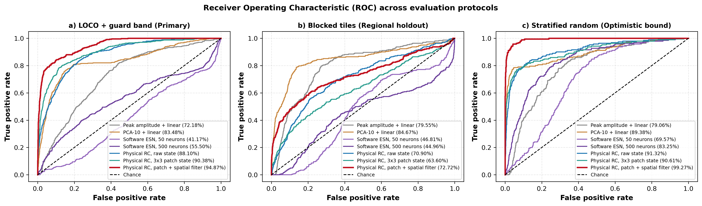
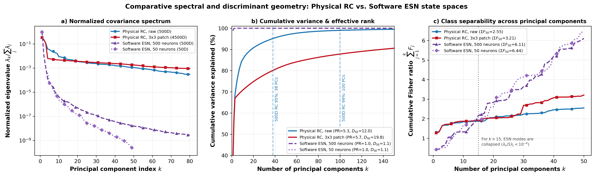
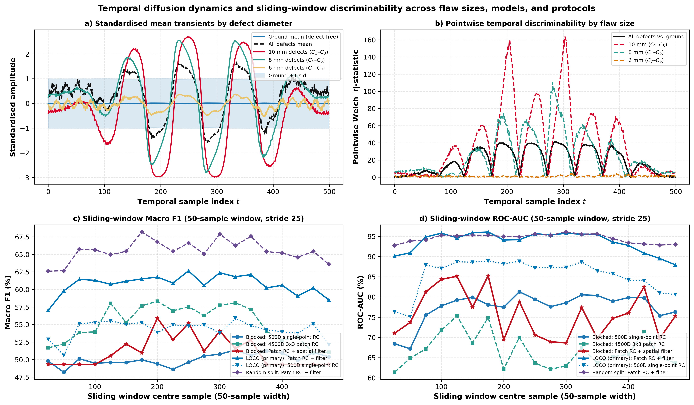
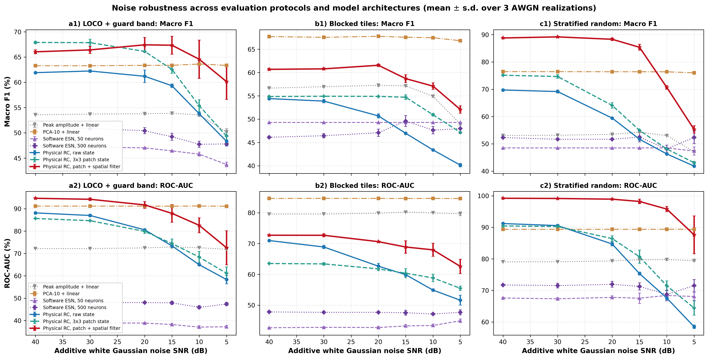
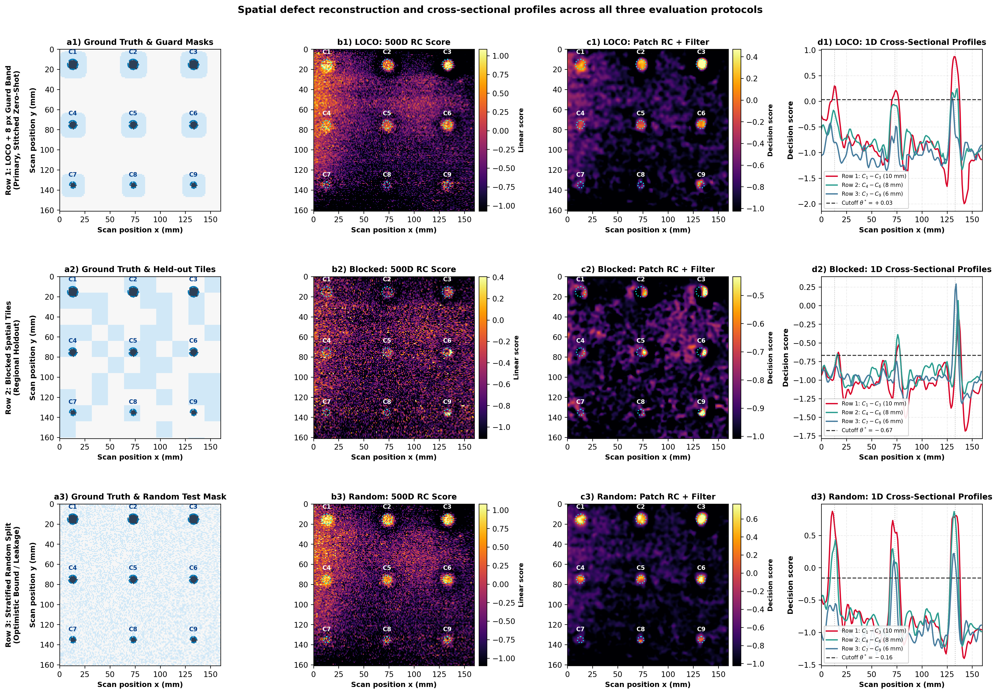

# Physical Reservoir Computing with Pulsed Eddy-Current Transients for Corrosion Detection and Sizing: What a Linear Readout Can and Cannot Recover

**Authors:** Thanh Dat Ly¹ and Minhhuy Le²\*  
¹ *ICSLab, Phenikaa School of Engineering, Phenikaa University, Hanoi 12116, Vietnam*  
² *Faculty of Electrical and Electronic Engineering, Phenikaa School of Engineering, Phenikaa University, Hanoi 12116, Vietnam*  
\* Corresponding author: `huy.leminh@phenikaa-uni.edu.vn`

---

> ### 📌 Note on Code & Dataset Availability (Peer-Review Preview Release)
> **This repository currently hosts the core model implementation (`models.py`), evaluation & verification modules (`evaluate.py`, `verify.py`), configuration files (`configs/config.json`), summary benchmark metrics (`runs/2026-08-28_final/metrics/`), and main result figures.**
>
> **The remaining components — including the raw 25,760-point 500-channel PECT scan dataset, data loader & signal-validated label registration (`dataset.py`), full training & cross-validation pipeline (`train.py`), figure generation pipeline (`visualize.py`), fitted fold checkpoints (`runs/*/models/*.pkl`), and out-of-fold prediction arrays (`runs/*/predictions/*.npz`) — are temporarily withheld while the manuscript is under peer review and will be pushed in full immediately upon formal acceptance of the manuscript.**

---

## 1. Overview

Pulsed eddy-current testing (PECT) interrogates conductive specimens via broadband electromagnetic diffusion, where temporal dissipation ($\tau_{\mathrm{d}} \sim \mu\sigma L^2$) naturally encodes subsurface material loss across penetration depths. This work demonstrates that the raw digitized Hall-sensor diffusion transient ($\mathbf{s}_{x,y} \in \mathbb{R}^{500}$) and its local $3\times 3$ spatio-temporal neighborhood ($\mathbf{p}_{x,y} \in \mathbb{R}^{4500}$) can serve directly as the state of a **linear physical reservoir computer**, enabling unseen defect detection and lateral diameter sizing through closed-form ridge readouts ($\mathbf{w}^{\mathrm{T}}\mathbf{z} + b$) without artificial recurrent layers or deep neural networks.



### Main Contributions
1. **Linear Physical Reservoir Readout for PECT**: Shows that raw electromagnetic diffusion transients support unseen subsurface defect detection with a closed-form ridge readout, outperforming parameter-matched 500-unit Software Echo State Networks (`68.21%` vs `53.63%` LOCO Macro F1; `94.77%` vs `54.65%` fold-averaged ROC-AUC with spatial post-filtering) and scalar peak indicators (`53.46%` Macro F1) on the Al2024 benchmark plate.
2. **Guard-Band Spatial Evaluation Protocol**: Uses **Leave-One-Corrosion-Out (LOCO) with an 8 px (8 mm) exclusion guard band** as the primary benchmark protocol for raster-scanned NDE, quantifying a **22.43 percentage-point Macro F1 inflation** under conventional random pixel splitting (`88.73%` vs `66.30%`).
3. **Signal-Validated Label Registration**: Aligns ground-truth defect coordinates against the 500-channel electromagnetic transients via multi-channel Welch $t^2$ maximization, identifying a $(-2, 0)\text{ px}$ mechanical origin offset ($1.362\times$ total Welch $t^2$ contrast gain).
4. **Scope and Limits of Linear Readouts**: Evaluates what a linear ridge readout can and cannot recover from single-specimen PECT scans: it estimates held-out lateral defect diameter across the 9 machined flaws ($R^2 = 0.968$, $\mathrm{RMSE} = 0.29\text{ mm}$, $\mathrm{MAE} = 0.20\text{ mm}$), whereas continuous subsurface wall-loss depth/volume inversion and sequential Jaeger memory capacity ($MC$) cannot be identified from single-specimen, single-pulse linear calibration.

---

## 2. Evaluated Architectures & Experimental Setup



- **Specimen**: 3 mm thick Al2024 aluminum plate scanned over a $160 \times 161$ raster grid ($25,760$ scan points at $1\text{ mm}$ pitch) containing 9 subsurface flat-bottom defects ($C_1$–$C_9$) across three nominal diameters: $10\text{ mm}$ ($C_1$–$C_3$), $8\text{ mm}$ ($C_4$–$C_6$), and $6\text{ mm}$ ($C_7$–$C_9$), representing a $1.85\%$ positive defect pixel ratio.
- **PECT Hardware**: 17 mm outer-diameter cylindrical probe with a 10 mm excitation coil (driven by a 4 V, 200 Hz Gaussian pulse) and a central InSb Hall sensor digitized at $100\text{ kHz}$ ($N = 500$ temporal samples per spatial coordinate).

---

## 3. Main Experimental Results

### 3.1. Defect Detection Benchmark Across Protocols

| Protocol | Model | State Dim. | Macro F1 (%) | Accuracy (%) | Defect Recall (%) | ROC-AUC (%) |
| :--- | :--- | :---: | :---: | :---: | :---: | :---: |
| **LOCO + 8 px guard band** *(Primary)* | Peak amplitude (`peak1`) | 1 | 53.46 ± 8.76 | 84.14 ± 6.61 | 24.96 | 72.16 |
| | PCA (`pca10`) | 10 | 63.28 ± 14.47 | 91.49 ± 5.90 | 33.25 | 91.18 |
| | Software ESN (`esn50`) | 50 | 48.61 ± 4.13 | 87.07 ± 4.97 | 6.90 | 39.84 |
| | Software ESN (`esn500`) | 500 | 53.63 ± 7.09 | 87.76 ± 5.42 | 14.66 | 54.65 |
| | Physical RC, raw (`rc500`) | 500 | 62.31 ± 11.64 | 92.27 ± 2.14 | 24.26 | 88.23 |
| | Physical RC, 3×3 patch (`patch4500`) | 4500 | **68.21 ± 13.15** | 93.47 ± 1.64 | **32.94** | 85.81 |
| | **Physical RC, filtered patch (`patch4500_filt`)** | **4500** | **66.30 ± 19.35** | **94.39 ± 1.84** | **31.59** | **94.77** *(94.87 pooled)* |
| **Blocked spatial tiles** *(Secondary)* | Physical RC, raw (`rc500`) | 500 | 54.57 | 95.28 | 11.26 | 70.90 |
| | **Physical RC, filtered patch (`patch4500_filt`)** | **4500** | **60.80** | **97.38** | **14.24** | **72.72** |
| **Stratified random split** *(Optimistic bound)* | Physical RC, raw (`rc500`) | 500 | 70.60 | 97.98 | 39.79 | 91.32 |
| | **Physical RC, filtered patch (`patch4500_filt`)** | **4500** | **88.73** | **99.19** | **76.44** | **99.27** |



### 3.2. Comparative Spectral Geometry, Temporal Dynamics & Noise Robustness

- **Spectral & Discriminant Geometry (`fig08_spectrum.png`)**: Single-point physical states (`rc500`) exhibit $\mathrm{PR} = 5.31$ and $D_{\mathrm{SE}} = 12.02$ (38 PCs for 95% variance; $\mathrm{PR} = 5.65, D_{\mathrm{SE}} = 19.80$ for `patch4500`), whereas untuned Software ESNs (`esn500`, `esn50`) collapse onto a rank-one synchronized manifold ($\mathrm{PR} = 1.02, D_{\mathrm{SE}} = 1.07$).
- **Temporal Diffusion Dynamics (`fig09_temporal.png`)**: Pointwise Welch $|t|$ discriminability peaks in the intermediate-to-late diffusive decay around sample 286 ($|t| = 41.34$ overall; $|t| = 163.52$ at sample 303 for 10 mm flaws; $|t| = 110.29$ at sample 281 for 8 mm flaws).
- **Noise Robustness (`fig07_noise.png`)**: Under AWGN from 40 dB down to 5 dB, `patch4500_filt` maintains `91.72%` LOCO ROC-AUC (`67.43%` Macro F1) at 20 dB SNR, while `pca10` preserves `91.12%` LOCO ROC-AUC even at 5 dB SNR.





### 3.3. Spatial Defect Reconstruction Maps Across Evaluation Protocols



---

## 4. Repository Structure (Current Preview Release vs. Post-Acceptance Release)

```text
├── configs/
│   └── config.json                         # Model & evaluation protocol hyperparameters [INCLUDED]
├── figures/                                # Main manuscript figures (PNG, 300 DPI) [INCLUDED]
├── tables/                                 # Generated LaTeX benchmark tables [INCLUDED]
├── runs/2026-08-28_final/metrics/
│   ├── benchmark.json                      # Aggregate metrics across 7 models x 3 protocols [INCLUDED]
│   ├── diameter_regression.json            # Leave-one-defect-out lateral sizing metrics [INCLUDED]
│   └── not_measured.json                   # Unidentifiable quantities declaration [INCLUDED]
├── models.py                               # Core Physical RC, 3x3 Patch, PCA, Peak & ESN models [INCLUDED]
├── evaluate.py                             # Metric evaluation & characterization suite [INCLUDED]
├── verify.py                               # Automated zero-leakage & reproducibility verifier [INCLUDED]
├── dataset.py                              # [TO BE RELEASED UPON MANUSCRIPT ACCEPTANCE]
├── train.py                                # [TO BE RELEASED UPON MANUSCRIPT ACCEPTANCE]
└── visualize.py                            # [TO BE RELEASED UPON MANUSCRIPT ACCEPTANCE]
```

